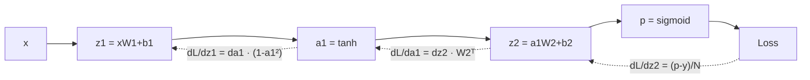

# 신경망과 역전파

!!! abstract "한 줄 요약"
    신경망은 **(행렬곱 + 비선형 함수)를 층층이 쌓은 함수**이고, 역전파는 그 함수의 기울기를 **연쇄법칙으로 뒤에서부터 효율적으로 계산**하는 방법입니다.

선행: [선형대수](03-linear-algebra.md), [미분과 경사하강법](04-calculus-gradient.md)

## 1. 뉴런과 층

한 층은 3-in-1입니다. 입력 $x$에 대해

$$
a = \sigma(xW + b)
$$

- $W$, $b$: 학습되는 파라미터
- $\sigma$: **활성화 함수** (비선형)

!!! important "왜 비선형이 필요한가"
    선형 층만 쌓으면 $W_2(W_1 x)=(W_2W_1)x$ 로 결국 **선형 층 하나**와 같습니다. 활성화 함수가 있어야 층을 쌓는 의미가 생깁니다.

| 활성화 | 식 | 특징 |
|---|---|---|
| sigmoid | $\frac{1}{1+e^{-x}}$ | 0~1, 이진 확률 출력에 사용. 깊은 층에서는 기울기 소실 |
| tanh | $\tanh x$ | -1~1, 평균이 0 |
| **ReLU** | $\max(0,x)$ | 단순하고 빠름. 은닉층의 기본값 |
| GELU | $x\,\Phi(x)$ | 트랜스포머에서 주로 사용 |

## 2. 순전파와 손실

2층 신경망 (입력 $x$, 은닉 $h$, 출력 $p$):

$$
z_1 = xW_1+b_1,\quad a_1=\tanh(z_1),\quad z_2=a_1W_2+b_2,\quad p=\sigma(z_2)
$$

이진 분류 손실(BCE):

$$
L=-\frac1N\sum\big[y\log p+(1-y)\log(1-p)\big]
$$

## 3. 역전파: 연쇄법칙의 반복

그래프를 뒤에서부터 거슬러 올라가며, 각 노드에서 **"위에서 내려온 기울기 × 내 지역 미분"** 을 다음 노드로 넘깁니다.



시그모이드 + BCE는 합쳐서 미분하면 아주 깔끔합니다.

$$
\frac{\partial L}{\partial z_2}=\frac{p-y}{N}
$$

이후 층마다:

$$
\frac{\partial L}{\partial W_2}=a_1^\top\,\delta_2,\quad
\frac{\partial L}{\partial a_1}=\delta_2 W_2^\top,\quad
\delta_1=\frac{\partial L}{\partial a_1}\odot(1-a_1^2),\quad
\frac{\partial L}{\partial W_1}=x^\top\delta_1
$$

!!! tip "shape로 검산하기"
    기울기의 shape는 항상 **그 파라미터의 shape와 같아야** 합니다. $W_2$가 (8,1)이면 `dW2`도 (8,1). 식이 헷갈리면 shape가 맞는 조합을 찾으세요.

## 4. NumPy로 밑바닥 구현 (XOR)

XOR은 선형으로 풀 수 없어서 은닉층이 필요한 고전 문제입니다.

```python
import numpy as np

X = np.array([[0,0],[0,1],[1,0],[1,1]], dtype=float)
y = np.array([[0],[1],[1],[0]], dtype=float)

rng = np.random.default_rng(0)
W1 = rng.normal(0, 1, (2, 8)); b1 = np.zeros(8)
W2 = rng.normal(0, 1, (8, 1)); b2 = np.zeros(1)
lr = 0.5

for epoch in range(5000):
    # 순전파
    z1 = X @ W1 + b1
    a1 = np.tanh(z1)
    z2 = a1 @ W2 + b2
    p = 1 / (1 + np.exp(-z2))
    loss = -(y * np.log(p) + (1 - y) * np.log(1 - p)).mean()

    # 역전파
    dz2 = (p - y) / len(X)
    dW2 = a1.T @ dz2
    db2 = dz2.sum(axis=0)
    da1 = dz2 @ W2.T
    dz1 = da1 * (1 - a1 ** 2)
    dW1 = X.T @ dz1
    db1 = dz1.sum(axis=0)

    # 업데이트
    W1 -= lr * dW1; b1 -= lr * db1
    W2 -= lr * dW2; b2 -= lr * db2

    if epoch % 1000 == 0:
        print(epoch, round(loss, 4))

print(p.round(3).ravel())   # 약 [0, 1, 1, 0]
```

## 5. 자동미분: 미니 micrograd

위처럼 손으로 미분하지 않아도, **연산을 기록해 두었다가 자동으로 역전파**하는 것이 PyTorch의 autograd입니다. 핵심을 40줄로 구현해 봅니다. (Karpathy의 micrograd 아이디어)

```python
import math

class Value:
    def __init__(self, data, children=()):
        self.data = data
        self.grad = 0.0
        self._backward = lambda: None
        self._prev = set(children)

    def __add__(self, other):
        other = other if isinstance(other, Value) else Value(other)
        out = Value(self.data + other.data, (self, other))
        def _backward():
            self.grad += out.grad
            other.grad += out.grad
        out._backward = _backward
        return out

    def __mul__(self, other):
        other = other if isinstance(other, Value) else Value(other)
        out = Value(self.data * other.data, (self, other))
        def _backward():
            self.grad += other.data * out.grad
            other.grad += self.data * out.grad
        out._backward = _backward
        return out

    def tanh(self):
        t = math.tanh(self.data)
        out = Value(t, (self,))
        def _backward():
            self.grad += (1 - t ** 2) * out.grad
        out._backward = _backward
        return out

    __radd__ = __add__
    __rmul__ = __mul__

    def backward(self):
        order, seen = [], set()
        def build(v):
            if v not in seen:
                seen.add(v)
                for c in v._prev:
                    build(c)
                order.append(v)
        build(self)
        self.grad = 1.0
        for v in reversed(order):
            v._backward()

# 검증: L = tanh(a*b + c)
a, b, c = Value(2.0), Value(-3.0), Value(10.0)
L = (a * b + c).tanh()
L.backward()
print(a.grad, b.grad, c.grad)
```

**기울기 누적(`+=`)** 이 중요합니다. 한 변수가 여러 곳에 쓰이면 각 경로의 기울기를 **더해야** 하기 때문입니다.

## 6. 학습이 안 될 때의 단골 원인

| 증상 | 원인 | 대응 |
|---|---|---|
| 손실이 `nan` | 학습률 과대, `log(0)` | 학습률↓, 수치 안정화(`eps`) |
| 손실이 안 줄어듦 | 학습률 과소, 버그 | 학습률 조정, 작은 데이터로 **과적합 되는지** 먼저 확인 |
| 깊을수록 학습 불가 | 기울기 소실/폭발 | ReLU, 적절한 초기화, 잔차 연결, 정규화 층 |

!!! note "디버깅 요령"
    새 모델은 먼저 **샘플 몇 개로 손실이 0 근처까지 떨어지는지** 확인하세요. 이게 안 되면 모델이나 학습 코드에 버그가 있는 겁니다.

## 연습문제

1. 활성화 함수 없이 3층을 쌓으면 표현력이 1층과 같은 이유를 식으로 보이세요.
2. $\sigma'(x)=\sigma(x)(1-\sigma(x))$ 의 최댓값은? 이것이 깊은 망에서 왜 문제인가요?
3. 위 XOR 코드에서 `tanh`를 ReLU로 바꾸려면 `dz1`의 식은 어떻게 되나요?
4. micrograd `Value`에 `__pow__`(정수 지수)를 추가하세요.

??? success "정답"
    1. $W_3(W_2(W_1x)) = (W_3W_2W_1)x$ 이므로 하나의 행렬 $W'$을 곱한 것과 같습니다.
    2. 최댓값은 $x=0$에서 **0.25**입니다. 층마다 0.25 이하를 곱하면 10층만 지나도 $0.25^{10}\approx10^{-6}$ 으로 기울기가 사라집니다.
    3. `a1 = np.maximum(0, z1)`, `dz1 = da1 * (z1 > 0)`
    4. ```python
       def __pow__(self, k):
           out = Value(self.data ** k, (self,))
           def _backward():
               self.grad += k * self.data ** (k - 1) * out.grad
           out._backward = _backward
           return out
       ```

## 참고

- 3Blue1Brown, *Neural Networks* (1~4편)
- Karpathy, *The spelled-out intro to neural networks and backpropagation: building micrograd*
- 다음: [PyTorch 기초](08-pytorch.md)
