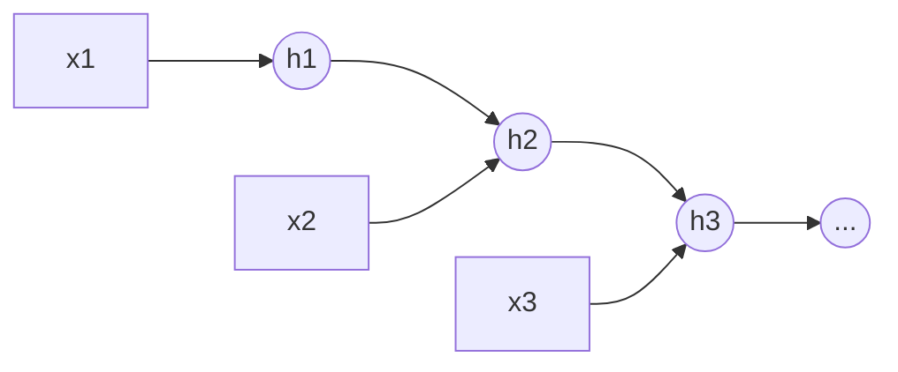
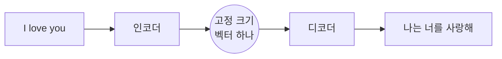

# RNN, LSTM, 그리고 어텐션의 등장

!!! abstract "한 줄 요약"
    RNN은 **순서가 있는 데이터를 한 칸씩 읽으며 기억을 갱신**합니다. 하지만 *긴 문장을 못 기억하고 병렬화가 안 되는* 한계 때문에, **어텐션**이 나왔고 결국 트랜스포머가 RNN을 대체했습니다.

선행: [PyTorch 기초](08-pytorch.md)

## 1. 시퀀스 데이터

문장, 음성, 주가처럼 **순서가 의미를 갖는** 데이터입니다. 길이가 가변이고, 앞의 내용이 뒤의 해석에 영향을 줍니다.

## 2. 기본 RNN

시점마다 **은닉 상태 $h_t$** 에 지금까지의 요약을 담아 다음으로 넘깁니다.

$$
h_t=\tanh(W_x x_t + W_h h_{t-1}+b)
$$



```python
import torch, torch.nn as nn

rnn = nn.RNN(input_size=8, hidden_size=16, batch_first=True)
x = torch.randn(4, 10, 8)            # (배치, 시퀀스 길이, 특징)
out, h_n = rnn(x)
print(out.shape, h_n.shape)          # (4,10,16), (1,4,16)
```

`out`은 모든 시점의 은닉 상태, `h_n`은 마지막 시점의 은닉 상태입니다.

## 3. 문제: 긴 의존성과 기울기 소실

시점 1의 정보가 시점 100에 영향을 주려면 기울기가 **100번의 곱셈**을 거칩니다. 각 곱이 1보다 작으면 0으로 사라지고, 크면 폭발합니다.

$$
\frac{\partial h_T}{\partial h_1}=\prod_{t=2}^{T}\frac{\partial h_t}{\partial h_{t-1}}
$$

→ 멀리 있는 단어와의 관계를 학습하지 못합니다. ([역전파의 기울기 소실](07-backprop.md))

## 4. LSTM / GRU: 게이트로 기억을 조절

LSTM은 **셀 상태 $c_t$** 라는 고속도로를 따로 두고, 게이트가 무엇을 지우고 쓰고 내보낼지 정합니다.

| 게이트 | 역할 |
|---|---|
| 망각(forget) | 이전 기억 중 무엇을 버릴까 |
| 입력(input) | 새 정보 중 무엇을 저장할까 |
| 출력(output) | 기억 중 무엇을 내보낼까 |

$$
c_t=f_t\odot c_{t-1}+i_t\odot\tilde c_t
$$

덧셈 경로 덕분에 기울기가 훨씬 잘 흐릅니다. (잔차 연결과 같은 발상) GRU는 이를 게이트 2개로 단순화한 버전입니다.

```python
lstm = nn.LSTM(input_size=8, hidden_size=16, num_layers=2,
               batch_first=True, bidirectional=False)
out, (h_n, c_n) = lstm(torch.randn(4, 10, 8))
print(out.shape)          # (4, 10, 16)
```

### 문자 단위 언어 모델의 뼈대

```python
class CharLM(nn.Module):
    def __init__(self, vocab, d_emb=32, d_hid=128):
        super().__init__()
        self.emb = nn.Embedding(vocab, d_emb)
        self.lstm = nn.LSTM(d_emb, d_hid, batch_first=True)
        self.out = nn.Linear(d_hid, vocab)

    def forward(self, idx):                 # idx: (B, T) 정수
        h, _ = self.lstm(self.emb(idx))
        return self.out(h)                  # (B, T, vocab) -> 다음 글자 예측
```

"앞 글자들이 주어졌을 때 다음 글자를 맞춘다"는 **언어 모델링** 구조는 GPT와 똑같습니다. 달라진 것은 `LSTM`이 **어텐션**으로 바뀐 것뿐입니다.

## 5. Seq2Seq와 병목

번역은 인코더 RNN이 문장을 읽고, 디코더 RNN이 번역문을 생성합니다.



**문제**: 문장이 아무리 길어도 **벡터 하나**에 모든 정보를 압축해야 해서 긴 문장일수록 번역 품질이 급락합니다.

## 6. 어텐션: 필요한 곳을 다시 본다

디코더가 단어를 하나 만들 때마다 **인코더의 모든 시점 상태를 훑어보고, 관련 높은 곳에 가중치를 더 줍니다.**

$$
\alpha_{t,s}=\mathrm{softmax}_s\big(\mathrm{score}(d_t,\,e_s)\big),\qquad
c_t=\sum_s \alpha_{t,s}\,e_s
$$

- $e_s$: 인코더의 $s$번째 상태, $d_t$: 디코더의 현재 상태
- $\alpha$: "지금 출력할 단어는 입력의 어디를 봐야 하나"의 가중치 (합이 1)
- $c_t$: 가중 평균으로 만든 문맥 벡터

```python
import numpy as np

def softmax(z):
    e = np.exp(z - z.max()); return e / e.sum()

enc = np.random.default_rng(0).normal(size=(5, 4))   # 입력 5단어, 상태 4차원
dec = np.random.default_rng(1).normal(size=4)         # 디코더 현재 상태

alpha = softmax(enc @ dec)        # 내적 점수 -> 확률
context = alpha @ enc             # 가중 평균
print(alpha.round(2), context.shape)
```

## 7. 그리고 트랜스포머로

2017년 *Attention Is All You Need* 의 발상:

> **RNN을 아예 없애고 어텐션만 쓰자.**

| | RNN/LSTM | 트랜스포머 |
|---|---|---|
| 처리 방식 | 순차적 (앞 단계가 끝나야 다음) | **전체 병렬** |
| 먼 단어 연결 | 여러 단계를 거침 | **한 번에 직접 연결** |
| 학습 속도 | 느림 | GPU에서 매우 빠름 → 큰 모델 가능 |
| 단점 | 기울기 소실, 병렬화 불가 | 계산량이 시퀀스 길이의 **제곱** |

이 병렬화 덕분에 대규모 학습이 가능해졌고 LLM의 시대가 열렸습니다. 다음 노트부터가 본론입니다.

## 연습문제

1. `nn.LSTM(10, 20, batch_first=True)`에 (3, 7, 10) 입력을 넣으면 `out`과 `h_n`의 shape는?
2. 기본 RNN이 긴 문장을 못 다루는 이유를 한 문장으로 설명하세요.
3. 어텐션 가중치 $\alpha$의 합은 얼마이고, 왜 softmax를 쓰나요?
4. 입력이 1,000 토큰일 때 어텐션 점수 행렬의 크기는? 이것이 왜 비용 문제가 되나요?

??? success "정답"
    1. `out`: (3, 7, 20), `h_n`: (1, 3, 20)
    2. 기울기가 시점마다 곱해지며 사라져 먼 과거의 정보가 학습되지 않기 때문입니다.
    3. 합은 1. 점수를 **확률 분포**로 바꿔 "어디에 얼마나 집중하는지"를 해석 가능한 가중치로 만들기 위해서입니다.
    4. 1,000×1,000 = 100만 개. 길이가 2배가 되면 계산·메모리가 **4배**가 되어, 긴 문맥 처리의 핵심 병목이 됩니다.

## 참고

- Jay Alammar, *Visualizing Neural Machine Translation (Seq2seq with Attention)*
- Christopher Olah, *Understanding LSTM Networks*
- 다음: [토큰화와 임베딩](11-tokenization-embedding.md)
