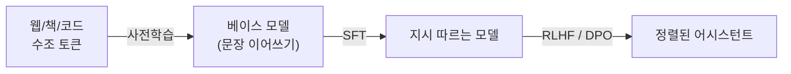

# LLM의 학습과 추론

!!! abstract "한 줄 요약"
    LLM은 **① 거대한 텍스트로 다음 토큰 예측을 학습(사전학습)** → **② 지시를 따르도록 조정(SFT)** → **③ 사람이 선호하는 답으로 정렬(RLHF/DPO)** 의 3단계로 만들어지고, 추론 때는 **확률 분포에서 토큰을 하나씩 뽑아** 문장을 만듭니다.

선행: [트랜스포머](transformer.md), [확률과 통계](05-probability.md)

## 1. 전체 파이프라인



## 2. 사전학습 (Pretraining)

목표는 단 하나, **다음 토큰 맞추기**입니다.

$$
L=-\frac1T\sum_{t}\log p_\theta(x_t\mid x_{<t})
$$

[교차 엔트로피](05-probability.md)를 모든 위치에서 평균한 것입니다. 이 단순한 목표를 충분한 데이터·규모로 풀면 문법, 사실 지식, 추론 패턴이 부산물로 학습됩니다.

```python
import torch.nn.functional as F

# logits: (B, T, V), idx: (B, T)  -> 한 칸 어긋나게 비교
logits = model(idx[:, :-1])
loss = F.cross_entropy(logits.reshape(-1, logits.size(-1)), idx[:, 1:].reshape(-1))
```

핵심은 **입력은 앞부분, 정답은 한 칸 뒤로 민 것**이라는 점입니다. 사람이 라벨을 달 필요가 없어서 인터넷 전체를 쓸 수 있습니다. (자기지도학습)

### 학습 규모의 감각

- 데이터: 수조(10¹²) 토큰
- 학습 비용 근사: $\text{FLOPs}\approx 6\,N\,D$ ($N$: 파라미터 수, $D$: 토큰 수)
- 수천~수만 개의 GPU를 수주~수개월 사용

### 스케일링 법칙

모델 크기, 데이터, 연산량을 늘리면 손실이 **예측 가능하게** 줄어듭니다. DeepMind의 Chinchilla 연구는 주어진 연산량에서 **모델 크기와 데이터를 같은 비율로** 키워야 하며, 대략 파라미터당 20토큰 정도가 효율적이라고 제시했습니다. 최근에는 추론 비용을 아끼려고 이보다 훨씬 많은 데이터로 작은 모델을 오래 학습하는 흐름도 흔합니다.

## 3. 지도 미세조정 (SFT)

베이스 모델은 질문을 받으면 "이어 쓰기"를 합니다. (질문 뒤에 또 다른 질문을 쓰기도 함) 사람이 쓴 **(지시, 좋은 응답) 쌍** 수만~수십만 개로 같은 손실을 이어서 학습하면 지시를 따르는 모델이 됩니다.

!!! note "손실 마스킹"
    보통 **응답 부분의 토큰에만** 손실을 계산합니다. 프롬프트를 따라 쓰게 학습시킬 이유가 없기 때문입니다.

## 4. 선호 정렬 (RLHF, DPO)

"좋은 답"의 정의를 한 가지 정답으로 쓰기 어렵습니다. 대신 **같은 질문에 대한 두 답 중 어느 쪽이 나은지** 사람(또는 AI)이 비교하게 합니다.

| 방법 | 방식 |
|---|---|
| **RLHF** | 선호 데이터로 보상 모델 학습 → 강화학습(PPO 등)으로 보상이 높은 답을 생성하도록 모델 조정 |
| **DPO** | 보상 모델·강화학습 없이 선호 쌍으로 직접 손실을 계산 (더 단순) |
| **RLAIF / Constitutional AI** | 사람 대신 **원칙(헌법)에 따른 AI 피드백** 사용 |
| **검증 가능한 보상 RL** | 수학·코드처럼 정답 판정이 자동인 문제로 추론 능력 강화 |

정렬은 도움이 되고, 정직하고, 해롭지 않은 방향으로 행동을 다듬는 단계입니다.

## 5. 추론: 토큰을 하나씩 뽑기

모델은 매 단계 어휘 전체에 대한 확률분포를 냅니다. 다음 토큰을 **뽑는 방식**이 출력 성격을 좌우합니다.

| 방식 | 설명 | 특징 |
|---|---|---|
| greedy | 가장 확률 높은 것 선택 | 결정적, 반복에 빠지기 쉬움 |
| **temperature** | logits를 $T$로 나눈 뒤 softmax | $T$↓ 보수적, $T$↑ 다양/무작위 |
| **top-k** | 확률 상위 $k$개 중에서만 샘플 | 이상한 꼬리 후보 제거 |
| **top-p (nucleus)** | 누적확률이 $p$가 될 때까지의 후보에서 샘플 | 상황에 따라 후보 수가 변함 |

```python
import torch, torch.nn.functional as F

def sample(logits, temperature=1.0, top_k=None, top_p=None):
    logits = logits / max(temperature, 1e-8)
    if top_k is not None:
        v, _ = torch.topk(logits, top_k)
        logits[logits < v[..., -1, None]] = float("-inf")
    probs = F.softmax(logits, dim=-1)
    if top_p is not None:
        sp, si = torch.sort(probs, descending=True)
        cum = sp.cumsum(-1)
        sp[(cum - sp) > top_p] = 0            # 누적이 p를 넘기 전까지만 유지
        probs = torch.zeros_like(probs).scatter(-1, si, sp)
        probs = probs / probs.sum(-1, keepdim=True)
    return torch.multinomial(probs, 1)

@torch.no_grad()
def generate(model, idx, n_new, max_len=128, **kw):
    for _ in range(n_new):
        logits = model(idx[:, -max_len:])[:, -1, :]    # 마지막 위치만
        idx = torch.cat([idx, sample(logits, **kw)], dim=1)
    return idx
```

### 온도가 하는 일

```python
import numpy as np
logits = np.array([2.0, 1.0, 0.1])
for T in [0.2, 1.0, 5.0]:
    p = np.exp(logits / T); p /= p.sum()
    print(T, p.round(3))
# T 작음 -> 한 곳에 쏠림 / T 큼 -> 균등에 가까움
```

!!! warning "API 사용 시"
    최신 Claude 모델 등 일부 모델은 `temperature`, `top_p` 같은 샘플링 파라미터를 요청에 보내면 거부하는 경우가 있습니다. 모델별 문서를 확인하세요.

## 6. KV 캐시

생성할 때 새 토큰 하나를 만들려고 이전 토큰들의 K, V를 매번 다시 계산하면 낭비입니다. **한 번 계산한 K, V를 저장**해 두고 새 토큰의 Q만 계산합니다.

- 속도: 토큰당 계산이 시퀀스 길이에 대해 선형으로 감소
- 대가: 문맥이 길고 동시 사용자가 많을수록 **GPU 메모리**를 크게 차지
- 그래서 프롬프트 캐싱, GQA 같은 기법이 중요합니다.

## 7. 환각과 한계

모델은 "그럴듯한 다음 토큰"을 뽑는 기계라서, 모르는 것도 자신 있게 이어 쓸 수 있습니다.

| 문제 | 대응 |
|---|---|
| 환각 (없는 사실 생성) | 근거 문서를 주는 [RAG](14-rag.md), 출처 요구, 모른다고 말하게 유도 |
| 최신 정보 부재 | 검색 도구 연결 ([에이전트](16-agents.md)) |
| 계산/논리 실수 | 코드 실행 도구, 단계별 추론, 검증 |
| 긴 문맥에서 정보 누락 | 중요한 내용은 앞/뒤에 배치, 요약 |

## 8. 평가

- **퍼플렉서티**: $\exp(L)$. 낮을수록 다음 토큰을 잘 예측
- **벤치마크**: MMLU(지식), HumanEval/SWE-bench(코딩), GSM8K/MATH(수학) 등. 데이터 오염과 과적합 주의
- **사람/AI 선호 평가**, 그리고 **내 과제 전용 평가셋**이 가장 믿을 만합니다. ([프롬프트 엔지니어링](13-prompt-engineering.md))

## 연습문제

1. 파라미터 70억 모델을 1조 토큰으로 학습하는 데 필요한 FLOPs 근사는?
2. SFT에서 응답 토큰에만 손실을 계산하는 이유는?
3. 온도를 0에 가깝게 하면 출력은 어떤 샘플링과 같아지나요?
4. KV 캐시가 없으면 길이 $T$의 문장을 생성할 때 어텐션 계산 총량은 대략 어떻게 증가하나요?

??? success "정답"
    1. $6\times7\times10^9\times10^{12}=4.2\times10^{22}$ FLOPs
    2. 모델이 학습해야 할 것은 **프롬프트가 주어졌을 때의 좋은 응답**이지, 프롬프트 자체를 외우는 것이 아니기 때문입니다.
    3. **greedy** (가장 확률 높은 토큰만 선택)
    4. 매 단계 전체를 다시 계산하므로 총량이 대략 $T^3$에 비례하고, 캐시를 쓰면 $T^2$ 수준으로 줄어듭니다.

## 참고

- Karpathy, *Intro to Large Language Models*, *State of GPT*
- Hoffmann et al., *Training Compute-Optimal Large Language Models* (Chinchilla)
- Ouyang et al., *InstructGPT*, Rafailov et al., *DPO*
- 다음: [프롬프트 엔지니어링](13-prompt-engineering.md)
