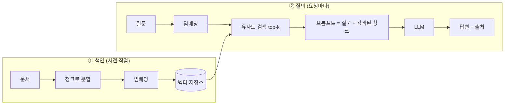

# RAG (검색 증강 생성)

!!! abstract "한 줄 요약"
    RAG는 모델이 답하기 전에 **관련 문서를 검색해서 프롬프트에 붙여 주는** 방식입니다. 모델을 다시 학습시키지 않고도 **최신·사내·개인 지식**을 반영하고, 환각을 줄이고, 출처를 댈 수 있습니다.

선행: [토큰화와 임베딩](11-tokenization-embedding.md), [프롬프트 엔지니어링](13-prompt-engineering.md)

## 1. 왜 RAG인가

LLM의 약점은 ① 학습 시점 이후 정보를 모르고, ② 내 문서를 모르고, ③ 모르는 걸 지어낼 수 있다는 점입니다. ([환각](12-llm-training.md))

| 방법 | 지식 주입 | 비용 | 갱신 |
|---|---|---|---|
| 프롬프트에 직접 붙이기 | 문서 전체 | 문서가 길면 비쌈/한계 | 즉시 |
| **RAG** | 관련 부분만 검색 | 낮음 | 문서만 바꾸면 즉시 |
| [파인튜닝](15-finetuning-lora.md) | 가중치에 반영 | 높음 | 재학습 필요 |

## 2. 파이프라인



## 3. 청킹

문서를 검색 단위로 자릅니다. **RAG 품질의 가장 큰 변수**입니다.

| 파라미터 | 너무 작으면 | 너무 크면 |
|---|---|---|
| 청크 크기 | 맥락이 끊김 | 관련 없는 내용이 섞여 검색 정밀도↓ |

- 보통 **200~800 토큰**에서 시작하고 실험으로 조정
- **의미 경계**(제목, 문단)를 따라 자르기
- 인접 청크와 **겹침(overlap)** 을 두어 경계의 정보 손실 방지
- 각 청크에 **메타데이터**(파일명, 섹션 제목)를 붙여 출처 표시와 필터링에 활용

## 4. 검색

### 밀집 검색 (임베딩)
질문과 청크를 같은 모델로 임베딩하고 코사인 유사도가 높은 순으로 가져옵니다. **표현이 달라도 의미가 비슷하면** 찾아냅니다.

### 키워드 검색 (BM25)
단어가 정확히 일치하는지 봅니다. **고유명사, 코드, 에러 메시지, 약어**에 강합니다.

### 하이브리드 + 재순위
둘을 합치고(예: RRF), 상위 후보를 **리랭커(cross-encoder)** 로 정밀하게 다시 정렬하면 보통 가장 좋습니다.

```python
import numpy as np

def cosine_top_k(q_vec, doc_vecs, k=3):
    q = q_vec / np.linalg.norm(q_vec)
    D = doc_vecs / np.linalg.norm(doc_vecs, axis=1, keepdims=True)
    sims = D @ q
    idx = np.argsort(-sims)[:k]
    return idx, sims[idx]
```

## 5. 생성 단계 프롬프트

```text
아래 <context>만을 근거로 질문에 답하세요.
- 근거가 없으면 "문서에서 찾을 수 없습니다"라고 답하세요.
- 답변 끝에 사용한 출처를 [파일명] 형식으로 표시하세요.

<context>
[01-numpy.md] ...
[06-ml-basics.md] ...
</context>

질문: {question}
```

핵심은 두 가지입니다: **"컨텍스트만 근거로"** 와 **"없으면 모른다고"** 지시. 컨텍스트가 지시가 아닌 데이터임을 태그로 분리합니다. ([프롬프트 인젝션](13-prompt-engineering.md))

## 6. 평가: 검색과 생성을 따로

문제가 어디서 생기는지 분리해서 봐야 고칠 수 있습니다.

| 단계 | 지표 | 질문 |
|---|---|---|
| 검색 | **Recall@k**, MRR | 정답 근거가 상위 k개 안에 있나? |
| 생성 | 충실성(faithfulness) | 답이 검색된 내용에 근거하나? |
| 생성 | 답 정확도 | 질문에 맞는 정답인가? |

**평가셋 만들기**: 문서에서 (질문, 정답 근거 청크) 쌍을 20~50개 만들어, 검색이 정답 청크를 상위에 가져오는지 먼저 측정합니다.

```python
def recall_at_k(eval_set, retrieve, k=3):
    hits = 0
    for q, gold_id in eval_set:
        ids = retrieve(q, k)
        hits += gold_id in ids
    return hits / len(eval_set)
```

## 7. 흔한 실패와 대응

| 증상 | 원인 | 대응 |
|---|---|---|
| 엉뚱한 청크가 검색됨 | 청크가 너무 큼/작음, 임베딩 모델 부적합 | 청킹 조정, 다국어 모델, 하이브리드 |
| 정답이 있는데 못 찾음 | 질문-문서 표현 차이 | 질문 재작성, 쿼리 확장 |
| 청크는 맞는데 답이 틀림 | 컨텍스트가 길어 정보 누락 | 리랭킹으로 k 줄이기, 중요한 것을 앞에 |
| 근거 없이 지어냄 | 프롬프트가 "모른다" 허용 안 함 | 거절 지시 + 충실성 평가 |
| 표/수식/이미지 | 텍스트 추출 한계 | 파서 개선, 구조 보존 |

!!! tip "가장 좋은 첫 개선"
    생성 모델을 바꾸기 전에 **검색 결과를 눈으로 보세요.** 대부분의 RAG 문제는 검색 단계에서 시작됩니다.

## 8. 벡터 저장소

학습용은 NumPy 배열이면 충분합니다. 문서가 수만 건을 넘으면 전용 도구를 씁니다.

| 도구 | 특징 |
|---|---|
| FAISS | 라이브러리, 빠른 근사 검색 |
| Chroma | 간단한 로컬 DB |
| pgvector | PostgreSQL 확장, 기존 DB와 통합 |
| Qdrant, Weaviate, Pinecone 등 | 전용 서버/서비스 |

## 9. 컨텍스트가 길면 RAG가 필요 없나?

컨텍스트 윈도우가 커졌지만 RAG는 여전히 유용합니다.
- 전체를 매번 넣으면 **비용과 지연**이 큼 (캐싱으로 완화 가능)
- 필요한 부분만 주면 **정확도가 오르는** 경우가 많음
- 문서가 컨텍스트보다 훨씬 많을 때는 필수

문서가 작고(수십 페이지) 자주 같이 쓴다면 **통째로 넣고 프롬프트 캐싱**이 더 단순할 수 있습니다.

## 연습문제

1. 청크 크기가 너무 작을 때와 너무 클 때의 문제를 각각 한 가지씩 말하세요.
2. "ERR_CONN_RESET 해결법" 같은 질의에 밀집 검색보다 BM25가 유리한 이유는?
3. RAG 시스템의 답이 틀렸을 때, 검색 문제인지 생성 문제인지 어떻게 구분하나요?
4. overlap을 두는 이유는?

??? success "정답"
    1. 작으면 문맥이 끊겨 의미를 잃고, 크면 무관한 내용이 섞여 검색 정밀도와 생성 품질이 떨어집니다.
    2. 에러 코드처럼 **정확한 문자열 일치**가 중요하고 의미 임베딩은 이런 희귀 토큰을 잘 구분하지 못할 수 있기 때문입니다.
    3. 정답 근거가 **검색된 청크 안에 있는지** 확인합니다. 없으면 검색 문제, 있는데 답이 틀리면 생성(프롬프트/모델) 문제입니다.
    4. 정보가 청크 경계에서 잘려 어느 쪽 청크에도 완전히 담기지 않는 일을 막기 위해서입니다.

## 참고

- 실습: [내 노트로 질문에 답하는 챗봇](../practice/rag-chatbot.md)
- 다음: [파인튜닝과 LoRA](15-finetuning-lora.md)
