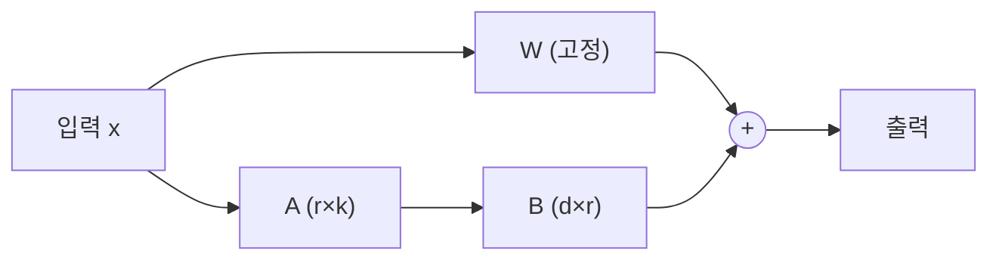

# 파인튜닝과 LoRA

!!! abstract "한 줄 요약"
    파인튜닝은 사전학습 모델을 **내 데이터로 추가 학습**해 행동·말투·형식을 바꾸는 방법입니다. **LoRA**는 원래 가중치를 얼려 두고 *아주 작은 보조 행렬만 학습*해서, 적은 메모리로 비슷한 효과를 냅니다.

선행: [트랜스포머](transformer.md), [LLM의 학습과 추론](12-llm-training.md), [선형대수](03-linear-algebra.md)

## 1. 먼저 물어볼 것: 정말 파인튜닝이 필요한가

| 하고 싶은 것 | 먼저 시도 | 파인튜닝이 적합한 경우 |
|---|---|---|
| 새로운 지식/최신 정보 | [RAG](14-rag.md) | 지식 주입에는 비효율적 |
| 형식·어조 맞추기 | [프롬프트 + 예시](13-prompt-engineering.md) | 프롬프트로 안정적이지 않을 때 |
| 특정 작업 정확도↑ | 더 나은 프롬프트, 더 큰 모델 | 평가셋이 있고, 프롬프트의 한계가 확인됐을 때 |
| 비용/지연↓ (작은 모델로) | 모델 선택 | 큰 모델의 행동을 작은 모델로 증류 |
| 도메인 특화 분류/추출 | 먼저 프롬프트로 기준선 측정 | 대량 처리 + 일관성이 필요할 때 |

!!! important "순서"
    **프롬프트 → RAG → 파인튜닝** 순으로 시도하세요. 파인튜닝은 데이터 준비, 학습, 평가, 재학습의 비용이 가장 큽니다. 그리고 "사실 지식을 넣는 용도"로는 잘 맞지 않습니다.

## 2. 전체 미세조정(Full Fine-tuning)의 부담

모든 파라미터를 학습하면 메모리가 이렇게 듭니다. (혼합정밀도 Adam, 파라미터당 대략)

- 가중치 + 기울기 + 옵티마이저 상태(2개) ≈ **파라미터당 12~16바이트**
- 70억 모델 → 약 **100GB 이상**

일반 GPU로는 불가능에 가깝고, 작업마다 모델 전체 사본을 저장해야 합니다.

## 3. LoRA: 변화량을 저랭크로 근사

핵심 가정: **미세조정으로 생기는 가중치 변화 $\Delta W$는 저랭크(low-rank)** 입니다.

$$
W' = W + \Delta W = W + \frac{\alpha}{r}\,BA,\qquad
B\in\mathbb{R}^{d\times r},\;A\in\mathbb{R}^{r\times k},\;r\ll\min(d,k)
$$

- $W$: 원래 가중치 (**고정**, 학습 안 함)
- $A, B$: 새로 추가하는 작은 행렬 (**이것만 학습**)
- $B$는 0으로, $A$는 작은 랜덤값으로 초기화 → 시작 시점에는 원래 모델과 동일



### 파라미터 절감 계산

$d=k=4096$ 한 층에 대해:

| 방식 | 학습 파라미터 |
|---|---|
| 전체 | 4096 × 4096 = **16,777,216** |
| LoRA ($r=8$) | 4096×8 + 8×4096 = **65,536** (약 0.4%) |

```python
import torch, torch.nn as nn

class LoRALinear(nn.Module):
    def __init__(self, base: nn.Linear, r=8, alpha=16):
        super().__init__()
        self.base = base
        for p in self.base.parameters():
            p.requires_grad = False                         # 원래 가중치 고정
        self.A = nn.Parameter(torch.randn(r, base.in_features) * 0.01)
        self.B = nn.Parameter(torch.zeros(base.out_features, r))
        self.scale = alpha / r

    def forward(self, x):
        return self.base(x) + (x @ self.A.T @ self.B.T) * self.scale

layer = LoRALinear(nn.Linear(4096, 4096), r=8)
trainable = sum(p.numel() for p in layer.parameters() if p.requires_grad)
print(trainable)         # 65,536
```

### 장점
- **메모리·시간 절감**: 학습 대상이 극소수
- **작은 어댑터 파일**(수 MB~수십 MB)만 저장 → 하나의 베이스 모델에 작업별 어댑터를 교체해 사용
- 배포 시 $W+BA$로 **합쳐서(merge)** 추가 지연 없이 사용 가능

### 주요 하이퍼파라미터
| 이름 | 의미 | 시작값 |
|---|---|---|
| `r` (rank) | 어댑터의 표현력 | 8~16 |
| `alpha` | 변화량의 크기 조절 ($\alpha/r$) | `r`의 1~2배 |
| `target_modules` | LoRA를 붙일 층 (보통 어텐션의 q, v 또는 모든 선형층) | 모델마다 다름 |
| `dropout` | 과적합 방지 | 0.05 |
| 학습률 | 전체 미세조정보다 **높게** | 1e-4 ~ 2e-4 |

## 4. QLoRA

베이스 모델을 **4비트로 양자화**해 메모리에 올리고, 그 위에 LoRA 어댑터를 16비트로 학습합니다. 단일 GPU(수십 GB 이하)로 수십억 파라미터 모델을 미세조정할 수 있게 한 기법입니다.

## 5. 데이터가 전부다

파인튜닝 결과의 80%는 데이터 품질이 결정합니다.

- **양보다 질**: 수백~수천 개의 깨끗한 예시로도 형식·어조는 충분히 바뀝니다.
- **다양성**: 실제 입력 분포를 반영하고 어려운 사례를 포함
- **일관된 형식**: 응답 스타일이 섞이면 모델도 흔들림
- **학습/검증 분리**, 그리고 **파인튜닝 전 기준선 점수** 필수
- 잘못된 정답이나 중복이 섞이지 않았는지 샘플을 직접 읽어 보기

일반적인 지시-응답 데이터 형태:

```json
{"messages": [
  {"role": "user", "content": "환불 정책 알려줘"},
  {"role": "assistant", "content": "구매 후 7일 이내 미사용 제품은 ..."}
]}
```

## 6. 주의할 점

| 문제 | 설명 | 대응 |
|---|---|---|
| **파국적 망각** | 새 작업을 배우며 기존 능력이 저하 | 낮은 학습률, LoRA, 일반 데이터 혼합 |
| 과적합 | 소량 데이터를 외움 | 에폭 줄이기, 검증 손실 감시, 조기 종료 |
| 안전성 저하 | 미세조정이 정렬된 행동을 약화시킬 수 있음 | 안전 평가 포함 |
| 평가 부재 | "좋아진 느낌"은 착각 | 고정 평가셋으로 전/후 비교 |

## 7. 코드 맛보기 (Hugging Face PEFT)

```bash
pip install transformers peft datasets accelerate
```

```python
from transformers import AutoModelForSequenceClassification
from peft import LoraConfig, get_peft_model, TaskType

base = AutoModelForSequenceClassification.from_pretrained(
    "distilbert-base-uncased", num_labels=2
)
cfg = LoraConfig(
    task_type=TaskType.SEQ_CLS,
    r=8, lora_alpha=16, lora_dropout=0.05,
    target_modules=["q_lin", "v_lin"],      # DistilBERT 어텐션의 q, v 선형층 이름
)
model = get_peft_model(base, cfg)
model.print_trainable_parameters()
# trainable params: 약 0.07M || all params: 약 66M || trainable%: 약 1% 안팎
```

전체 학습 과정은 [LoRA 실습](../practice/lora-finetune.md)에서 합니다.

## 연습문제

1. $d=k=2048$, $r=16$일 때 LoRA 파라미터 수와 전체 대비 비율은?
2. LoRA에서 $B$를 0으로 초기화하는 이유는?
3. 회사 내부 문서에 대한 질문에 답하는 챗봇에는 파인튜닝과 RAG 중 무엇이 먼저인가요? 이유는?
4. 파인튜닝 전에 반드시 해 두어야 할 것은?

??? success "정답"
    1. $2048\times16\times2=65{,}536$. 전체는 $2048^2=4{,}194{,}304$이므로 **약 1.56%**
    2. 학습 시작 시 $BA=0$이라 $W'=W$, 즉 **사전학습된 모델의 동작을 그대로 유지한 채** 출발하기 위해서입니다.
    3. **RAG.** 지식은 문서만 바꾸면 즉시 갱신되고 출처를 댈 수 있으며, 파인튜닝은 사실 암기에 비효율적이고 갱신 때마다 재학습이 필요합니다.
    4. 대표 입력의 **평가셋과 기준선(프롬프트/RAG만으로의 성능)** 을 만들어 두는 것.

## 참고

- Hu et al., *LoRA: Low-Rank Adaptation of Large Language Models*
- Dettmers et al., *QLoRA*
- [Hugging Face PEFT 문서](https://huggingface.co/docs/peft)
- 다음: [에이전트와 도구 사용](16-agents.md)
