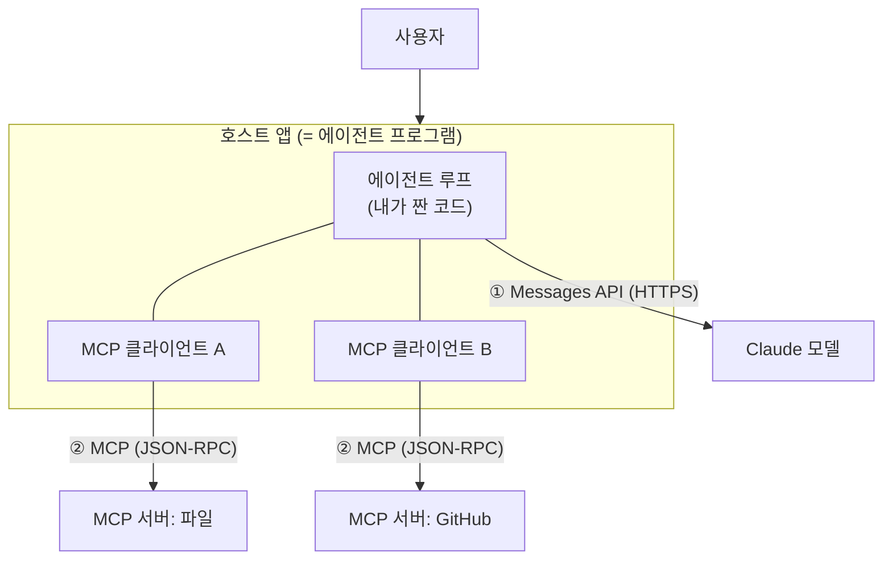
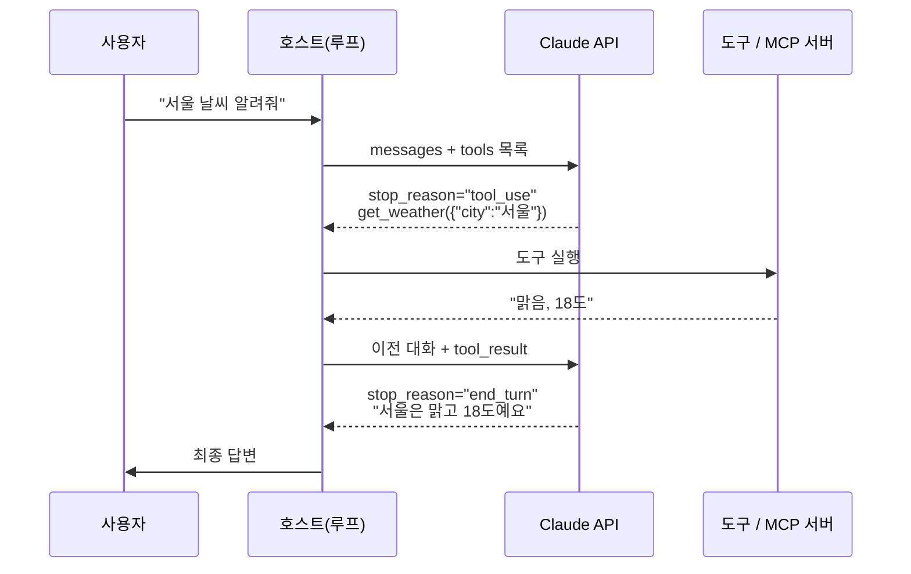
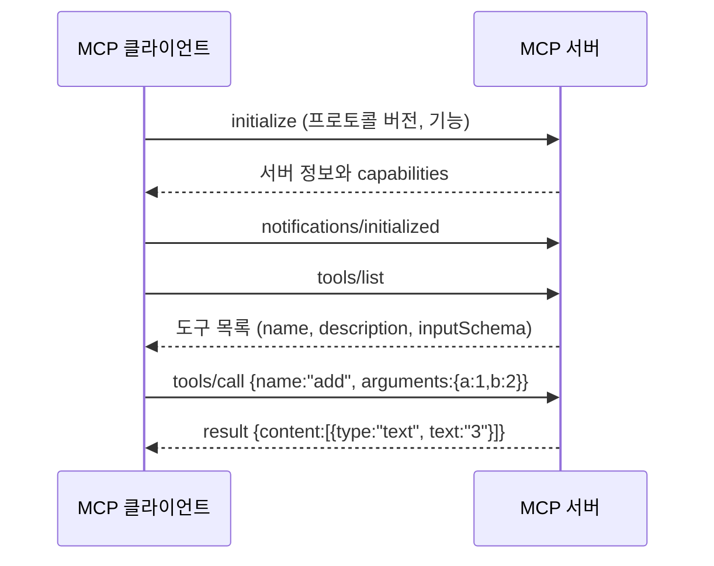
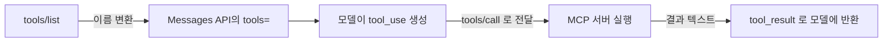

# MCP와 API 호출 구조

!!! abstract "한 줄 요약"
    **에이전트**는 "모델 호출 → 도구 실행 → 결과 전달"을 반복하는 루프이고, **MCP**는 그 루프에 도구를 꽂는 표준 규격입니다. 모델은 도구를 직접 실행하지 않으며, 모델과는 **API**로, 도구 서버와는 **MCP**로 말하는 것은 모두 **호스트 앱**입니다.

선행: [프롬프트 엔지니어링](13-prompt-engineering.md), [에이전트와 도구 사용](16-agents.md)

## 1. 큰 그림: 누가 누구와 말하는가



| 용어 | 정체 | 예 |
|---|---|---|
| **모델** | 텍스트와 "도구 호출 요청"을 생성하는 존재. 아무것도 실행하지 않는다 | Claude |
| **호스트** | 사용자가 쓰는 앱. 모델 호출과 도구 실행을 모두 조율한다 | Claude Desktop, Claude Code, 내가 만든 에이전트 |
| **에이전트 루프** | 호스트 안에서 모델 호출을 반복하는 코드 | 이 노트 3장의 `for` 문 |
| **MCP 클라이언트** | 호스트 안에서 서버 하나와 1:1 연결을 맡는 모듈 | SDK의 `ClientSession` |
| **MCP 서버** | 도구·자원·프롬프트를 노출하는 프로그램 | 파일 시스템 서버, GitHub 서버 |

!!! important "가장 흔한 오해"
    - 모델이 MCP 서버에 직접 접속하는 것이 **아닙니다**. 모델은 `tool_use` 요청만 내고, 서버로 전달하는 것은 호스트의 MCP 클라이언트입니다.
    - MCP 서버가 AI를 실행하는 것이 **아닙니다**. 서버는 도구를 노출할 뿐입니다.
    - MCP **없이도** 에이전트는 만들 수 있습니다([에이전트 노트](16-agents.md)처럼 도구를 코드에 직접 넣으면 됩니다). MCP는 도구를 **재사용·공유**하기 위한 규격입니다.

## 2. API 호출의 동작 방식

### 2.1 Messages API는 상태가 없다

요청마다 **대화 전체와 도구 목록을 다시 보냅니다.** 서버는 이전 요청을 기억하지 않습니다. 대화 기록은 호스트가 직접 쌓아 관리합니다.

```python
import anthropic

client = anthropic.Anthropic()  # ANTHROPIC_API_KEY 환경 변수를 읽는다

resp = client.messages.create(
    model="claude-opus-5-5",
    max_tokens=1024,
    messages=[{"role": "user", "content": "안녕"}],
)
print(resp.content[0].text)
print(resp.stop_reason)  # "end_turn"
print(resp.usage)        # input_tokens, output_tokens
```

!!! warning "샘플링 파라미터"
    최신 모델에서는 `temperature`, `top_p` 같은 파라미터를 지정하지 않는 것이 기본입니다. 필요한 경우가 아니면 넣지 마세요.

### 2.2 응답 구조

`resp.content`는 **블록의 리스트**입니다.

| 블록 `type` | 의미 | 주요 필드 |
|---|---|---|
| `text` | 모델이 쓴 글 | `text` |
| `tool_use` | 도구 호출 요청 | `id`, `name`, `input` |

`stop_reason`이 왜 멈췄는지 알려줍니다.

| `stop_reason` | 의미 | 호스트가 할 일 |
|---|---|---|
| `end_turn` | 답변 완료 | 루프 종료 |
| `tool_use` | 도구 호출을 기다리는 중 | 도구 실행 후 결과 전달 |
| `max_tokens` | 길이 제한에 걸려 잘림 | `max_tokens`를 늘리거나 이어서 요청 |

### 2.3 도구 사용 한 바퀴



주고받는 메시지를 풀어 쓰면 이렇습니다.

```json
// ① 요청 (호스트 → 모델)
{ "model": "claude-opus-5-5",
  "tools": [{ "name": "get_weather", "description": "...", "input_schema": {...} }],
  "messages": [{ "role": "user", "content": "서울 날씨 알려줘" }] }

// ② 응답 (모델 → 호스트)
{ "stop_reason": "tool_use",
  "content": [
    { "type": "text", "text": "날씨를 확인할게요." },
    { "type": "tool_use", "id": "toolu_01A", "name": "get_weather",
      "input": { "city": "서울" } } ] }

// ③ 다음 요청 (assistant 응답 + tool_result를 대화에 덧붙임)
{ "messages": [
    { "role": "user", "content": "서울 날씨 알려줘" },
    { "role": "assistant", "content": [ ...② 의 content 그대로... ] },
    { "role": "user", "content": [
        { "type": "tool_result", "tool_use_id": "toolu_01A",
          "content": "맑음, 18도" } ] } ] }
```

!!! important "규칙 네 가지"
    1. `tool_result`는 **user 역할** 메시지에 담고, `tool_use_id`는 요청의 `id`와 일치해야 한다.
    2. 한 턴에 `tool_use`가 여러 개 오면 결과를 **한 user 메시지에 모아서** 보낸다.
    3. assistant 응답은 `content` 블록을 **그대로** 대화에 추가한다.
    4. 도구를 강제로 쓰게 하는 `tool_choice`는 보통 필요 없다. 모델이 판단하게 둔다.

## 3. 에이전트 루프 구현

```python
import anthropic

client = anthropic.Anthropic()

tools = [{
    "name": "get_weather",
    "description": "도시 이름을 받아 현재 날씨를 반환한다. 한국 도시만 지원.",
    "input_schema": {
        "type": "object",
        "properties": {"city": {"type": "string", "description": "예: 서울"}},
        "required": ["city"],
    },
}]

def run_tool(name: str, args: dict) -> str:
    if name == "get_weather":
        return f"{args['city']}: 맑음, 18도"  # 실제로는 외부 API 호출
    return f"알 수 없는 도구: {name}"

def agent(question: str, max_steps: int = 10) -> str:
    messages = [{"role": "user", "content": question}]
    for _ in range(max_steps):                      # 무한 루프 방지
        resp = client.messages.create(
            model="claude-opus-5-5", max_tokens=1024,
            tools=tools, messages=messages,
        )
        messages.append({"role": "assistant", "content": resp.content})

        if resp.stop_reason != "tool_use":          # 끝났으면 종료
            return "".join(b.text for b in resp.content if b.type == "text")

        results = []
        for block in resp.content:
            if block.type == "tool_use":
                try:
                    out = run_tool(block.name, block.input)
                    results.append({"type": "tool_result",
                                    "tool_use_id": block.id, "content": out})
                except Exception as e:              # 실패도 모델에게 알린다
                    results.append({"type": "tool_result",
                                    "tool_use_id": block.id,
                                    "content": f"오류: {e}", "is_error": True})
        messages.append({"role": "user", "content": results})
    return "최대 반복 횟수를 넘었습니다."

print(agent("서울 날씨 알려줘"))
```

`max_steps`와 오류를 `tool_result`로 돌려주는 부분이 실전에서 중요합니다. 오류를 알려 주면 모델이 인자를 고쳐 다시 시도할 수 있습니다.

## 4. MCP란

### 4.1 왜 필요한가

도구를 앱마다 제각각 연결하면 **앱 N개 × 도구 M개**만큼 연결 코드가 필요합니다. MCP는 연결 방식을 표준화해서 **도구는 서버로 한 번만** 만들고, **앱은 클라이언트로 한 번만** 구현하면 서로 붙게 합니다. USB-C와 같은 발상입니다.

### 4.2 서버가 제공하는 세 가지

| 종류 | 누가 사용을 결정하나 | 예 |
|---|---|---|
| **Tools** | 모델이 필요할 때 호출 | `search_files`, `create_issue` |
| **Resources** | 앱이 읽어서 문맥에 넣음 | 파일 내용, DB 스키마 |
| **Prompts** | 사용자가 골라서 사용 | 재사용 가능한 프롬프트 템플릿 |

에이전트 개발에서 가장 많이 쓰는 것은 **Tools**입니다.

### 4.3 통신 방식

MCP는 **JSON-RPC 2.0** 메시지를 주고받습니다. 전송 수단은 두 가지입니다.

| 전송 방식 | 동작 | 용도 |
|---|---|---|
| **stdio** | 호스트가 서버를 자식 프로세스로 실행하고 표준 입출력으로 통신 | 로컬 도구 |
| **Streamable HTTP** | HTTP로 통신. 인증이 필요하면 OAuth 사용 | 원격·공유 서버 |

!!! warning "stdio 서버에서 `print()` 금지"
    stdout이 곧 통신 채널이라 `print()`로 찍은 글이 프로토콜 메시지를 깨뜨립니다. 로그는 stderr로 보내세요.

### 4.4 연결 생명주기



실제로 오가는 메시지는 이런 모양입니다.

```json
// 클라이언트 → 서버
{ "jsonrpc": "2.0", "id": 2, "method": "tools/call",
  "params": { "name": "add", "arguments": { "a": 1, "b": 2 } } }

// 서버 → 클라이언트
{ "jsonrpc": "2.0", "id": 2,
  "result": { "content": [ { "type": "text", "text": "3" } ], "isError": false } }
```

## 5. MCP와 Messages API가 만나는 지점

두 규격의 도구 모양이 거의 같기 때문에 **변환만 하면** 이어집니다.

| MCP `tools/list` 항목 | → | Messages API `tools=` 항목 |
|---|---|---|
| `name` | → | `name` |
| `description` | → | `description` |
| `inputSchema` | → | `input_schema` |



즉 3장의 루프에서 **`run_tool` 자리에 "MCP 서버로 `tools/call` 보내기"만 넣으면** MCP 에이전트가 됩니다. 구조는 그대로입니다.

## 6. 최소 MCP 서버

```python
# server.py   (pip install mcp)
from mcp.server.fastmcp import FastMCP

mcp = FastMCP("calc")

@mcp.tool()
def add(a: int, b: int) -> int:
    """두 정수를 더한다."""
    return a + b

@mcp.tool()
def word_count(text: str) -> int:
    """문자열의 단어 수를 센다. 공백 기준."""
    return len(text.split())

if __name__ == "__main__":
    mcp.run()  # 기본은 stdio
```

함수 이름, 타입 힌트, docstring이 각각 도구의 `name`, `inputSchema`, `description`이 됩니다.

## 7. 도구 설계 원칙

모델은 **description과 스키마만 보고** 도구를 고르고 인자를 채웁니다. 도구 설계는 곧 프롬프트 작성입니다.

- **언제 쓰는지**를 설명에 쓴다. ("파일명으로 검색할 때 사용. 내용 검색에는 `grep` 사용")
- 인자에 **예시와 단위**를 적는다. (`city`: 예 "서울")
- 도구 수를 **필요한 만큼만** 둔다. 정의가 매 요청의 입력 토큰을 차지하고, 비슷한 도구가 많으면 선택이 흔들린다.
- 결과는 **필요한 정보만 간결하게** 돌려준다. 통째로 넘기면 문맥을 낭비한다.
- 실패는 예외로 터뜨리지 말고 **이해할 수 있는 오류 메시지**로 돌려준다.

## 8. 보안과 통제

!!! danger "도구 결과도 입력이다"
    서버가 돌려준 텍스트나 웹 페이지 안에 "이전 지시를 무시하고 …" 같은 문장이 숨어 있을 수 있습니다(프롬프트 인젝션). 신뢰하지 않는 소스의 내용이 도구의 권한과 결합되면 위험합니다.

- **신뢰할 수 있는 서버만** 연결한다. 서버는 내 머신에서 코드를 실행할 수 있다.
- **최소 권한**: 읽기 전용으로 충분하면 쓰기 도구를 주지 않는다.
- 삭제·전송·결제 같은 **되돌릴 수 없는 작업은 사람 승인**을 거친다.
- API 키 등 비밀은 환경 변수로 관리하고, 서버 인자나 로그에 남기지 않는다.
- 에이전트에는 항상 **최대 반복 횟수**와 **토큰 예산**을 둔다.

## 9. 흔한 혼동

| 헷갈리는 것 | 정리 |
|---|---|
| 에이전트 vs MCP | 에이전트는 **루프**, MCP는 도구 **연결 규격**. 서로 독립적이다 |
| 도구 호출 vs 도구 실행 | 모델은 호출을 **요청**만 하고, 실행은 호스트가 한다 |
| API 호출 vs MCP 호출 | API는 **호스트↔모델**, MCP는 **호스트↔도구 서버** |
| Tools vs Resources | Tools는 모델이 행동을 요청, Resources는 앱이 읽어서 문맥에 제공 |
| stdio vs HTTP | 로컬 자식 프로세스 vs 네트워크 원격 서버 |

## 10. 연습문제

1. 모델이 MCP 서버에 `tools/call`을 직접 보내나요? 아니라면 누가 보내나요?
2. 한 턴에 `tool_use` 블록이 2개 왔을 때 `tool_result`는 어떻게 돌려줘야 하나요?
3. Messages API가 stateless라는 사실은 에이전트 코드에 어떤 의미가 있나요?
4. 팀원들이 함께 쓰는 원격 서버에는 stdio와 Streamable HTTP 중 어느 쪽이 맞나요?
5. stdio 서버 코드에 디버깅용 `print("start")`를 넣었더니 연결이 실패했습니다. 왜일까요?
6. `stop_reason == "max_tokens"`인 응답에 `tool_use` 블록이 들어 있습니다. 그대로 실행해도 될까요?

??? success "정답"
    1. 아니요. 호스트 앱의 MCP 클라이언트가 보냅니다. 모델은 `tool_use` 요청만 만듭니다.
    2. 각각 `tool_use_id`를 맞춘 `tool_result`로 만들어 **하나의 user 메시지 `content` 배열에 함께** 담습니다.
    3. 매 요청마다 대화 기록(assistant 응답 포함)과 도구 목록을 호스트가 다시 보내야 합니다. 대화가 길어질수록 입력 토큰이 늘어나므로 요약이나 캐싱을 고민해야 합니다.
    4. Streamable HTTP입니다. stdio는 같은 머신에서 자식 프로세스로 띄우는 로컬용입니다.
    5. stdout이 JSON-RPC 통신 채널이라 `print` 출력이 메시지 형식을 깨뜨립니다. 로그는 stderr로 보냅니다.
    6. 안 됩니다. 응답이 길이 제한으로 잘려 `input`이 불완전할 수 있습니다. `max_tokens`를 늘려 다시 요청하는 것이 안전합니다.

## 11. 참고 자료

- MCP 공식 문서: <https://modelcontextprotocol.io/>
- MCP Python SDK: <https://github.com/modelcontextprotocol/python-sdk>
- Anthropic — Building effective agents: <https://www.anthropic.com/engineering/building-effective-agents>
- Claude API 문서(도구 사용): <https://docs.claude.com/>

## 다음 단계

[MCP 서버 + 에이전트 연결 실습](../practice/mcp-agent.md)에서 직접 서버를 만들고 에이전트에 붙여 봅니다.
