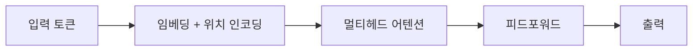

# 트랜스포머

## 핵심 아이디어

입력의 모든 토큰이 서로를 직접 참조하는 **셀프 어텐션**으로 문맥을 파악합니다.

$$
\mathrm{Attention}(Q,K,V)=\mathrm{softmax}\left(\frac{QK^\top}{\sqrt{d_k}}\right)V
$$

## 구조

!!! note "TODO"
    논문 *Attention Is All You Need* 읽고 내용 보강하기
