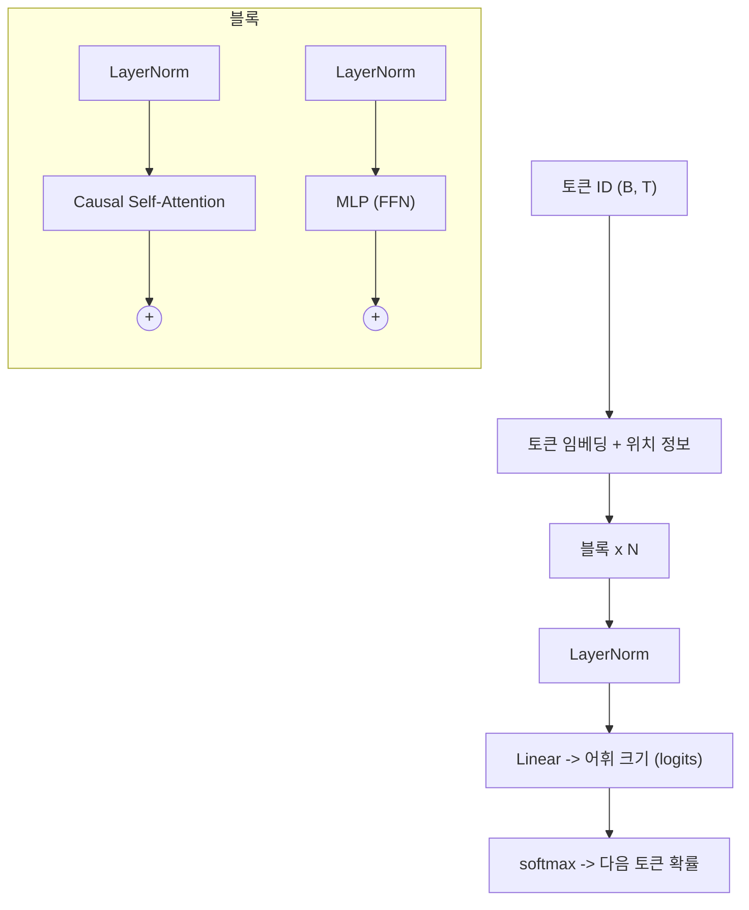

# 트랜스포머

!!! abstract "한 줄 요약"
    트랜스포머는 **모든 토큰이 서로를 직접 바라보는 셀프 어텐션**과 **토큰별 MLP**를, **잔차 연결 + 정규화**로 감싼 블록을 쌓은 구조입니다. GPT, Claude 등 현대 LLM의 뼈대입니다.

선행: [선형대수](03-linear-algebra.md), [RNN과 어텐션의 등장](10-rnn-attention.md), [토큰화와 임베딩](11-tokenization-embedding.md)
원논문: *Attention Is All You Need* (Vaswani et al., 2017)

## 1. 전체 구조 (GPT형, 디코더 전용)



한 블록은 두 단계입니다.

1. **어텐션**: 토큰들이 *서로 정보를 주고받음* (토큰 간 소통)
2. **MLP**: 각 토큰이 *혼자서 정보를 가공함* (토큰별 계산)

각 단계는 `x = x + 단계(LayerNorm(x))` 형태의 잔차 연결입니다.

## 2. 셀프 어텐션 한 걸음씩

각 토큰 벡터 $x$로부터 세 가지를 만듭니다.

- **Query ($q$)**: "나는 어떤 정보를 찾고 있나"
- **Key ($k$)**: "나는 이런 정보를 갖고 있다"
- **Value ($v$)**: "선택되면 내가 넘겨줄 내용"

$$
Q=XW_Q,\quad K=XW_K,\quad V=XW_V
$$

$$
\mathrm{Attention}(Q,K,V)=\mathrm{softmax}\!\left(\frac{QK^\top}{\sqrt{d_k}}\right)V
$$

1. $QK^\top$: 모든 토큰 쌍의 **유사도(내적)** → (T, T) 행렬
2. $\sqrt{d_k}$로 나눔: 내적 값이 차원에 따라 커져 softmax가 포화되는 것을 방지
3. softmax: 각 행을 **합이 1인 가중치**로
4. $V$와 곱함: 가중 평균으로 정보를 모음

```python
import numpy as np

def softmax(x, axis=-1):
    e = np.exp(x - x.max(axis=axis, keepdims=True))
    return e / e.sum(axis=axis, keepdims=True)

def attention(Q, K, V, mask=None):
    d_k = Q.shape[-1]
    scores = Q @ K.T / np.sqrt(d_k)          # (T, T)
    if mask is not None:
        scores = np.where(mask, scores, -1e9)
    w = softmax(scores)
    return w @ V, w

rng = np.random.default_rng(0)
T, d = 4, 8
X = rng.normal(size=(T, d))
Wq, Wk, Wv = (rng.normal(size=(d, d)) for _ in range(3))

out, w = attention(X @ Wq, X @ Wk, X @ Wv)
print(w.round(2))          # 각 행의 합이 1
print(out.shape)           # (4, 8)
```

## 3. 인과 마스크 (Causal Mask)

언어 모델은 **다음 토큰을 예측**하므로, 학습 중 미래 토큰을 엿보면 안 됩니다. 아래 삼각형 밖을 $-\infty$로 가려서 softmax 후 0이 되게 합니다.

```python
mask = np.tril(np.ones((T, T), dtype=bool))
print(mask.astype(int))
# [[1 0 0 0]
#  [1 1 0 0]
#  [1 1 1 0]
#  [1 1 1 1]]

out, w = attention(X @ Wq, X @ Wk, X @ Wv, mask)
print(w.round(2))          # 윗삼각이 모두 0
```

**한 번의 순전파로 모든 위치의 "다음 토큰 예측"을 동시에 학습**할 수 있다는 점이 큰 효율의 원천입니다.

## 4. 멀티헤드 어텐션

차원을 $h$개 머리로 쪼개 **서로 다른 관계**(문법, 지시 대상, 인접 단어 등)를 병렬로 학습하게 합니다. 결과는 이어 붙여 다시 선형 변환합니다.

$$
\mathrm{MHA}(X)=\mathrm{Concat}(\text{head}_1,\dots,\text{head}_h)\,W_O
$$

## 5. 위치 정보

어텐션은 순서를 모르는 **집합 연산**입니다. 위치를 알려줘야 합니다.

| 방식 | 설명 |
|---|---|
| 사인/코사인 (원논문) | 고정된 주기 함수를 더함 |
| 학습형 위치 임베딩 (GPT-2) | 위치마다 학습되는 벡터를 더함 |
| **RoPE** (최신 LLM 다수) | Q, K를 위치에 따라 **회전**시켜 상대 거리를 반영 |

```python
def sinusoidal_pe(T, d):
    pos = np.arange(T)[:, None]
    i = np.arange(d)[None, :]
    angle = pos / np.power(10000, (2 * (i // 2)) / d)
    pe = np.zeros((T, d))
    pe[:, 0::2] = np.sin(angle[:, 0::2])
    pe[:, 1::2] = np.cos(angle[:, 1::2])
    return pe
```

## 6. MLP와 정규화

**MLP(FFN)** 는 각 토큰에 독립적으로 적용됩니다.

$$
\mathrm{FFN}(x)=W_2\,\mathrm{GELU}(W_1x)\qquad (d \to 4d \to d)
$$

파라미터의 약 2/3가 여기에 있고, 모델이 사실 지식을 저장하는 곳으로 알려져 있습니다.

**LayerNorm**은 각 토큰 벡터를 평균 0, 분산 1로 맞춰 깊은 망의 학습을 안정시킵니다. 요즘 모델은 블록 **앞**에 두는 Pre-LN(또는 RMSNorm)을 주로 씁니다.

**잔차 연결**은 기울기가 지름길로 흐르게 하여 수십~수백 층을 쌓을 수 있게 합니다. ([ResNet](09-cnn.md))

## 7. PyTorch 구현

```python
import math
import torch, torch.nn as nn, torch.nn.functional as F

class CausalSelfAttention(nn.Module):
    def __init__(self, d_model, n_head, max_len):
        super().__init__()
        assert d_model % n_head == 0
        self.n_head = n_head
        self.qkv = nn.Linear(d_model, 3 * d_model)
        self.proj = nn.Linear(d_model, d_model)
        mask = torch.tril(torch.ones(max_len, max_len))
        self.register_buffer("mask", mask.view(1, 1, max_len, max_len))

    def forward(self, x):
        B, T, C = x.shape
        q, k, v = self.qkv(x).split(C, dim=2)
        # (B, T, C) -> (B, n_head, T, head_dim)
        q, k, v = (t.view(B, T, self.n_head, C // self.n_head).transpose(1, 2)
                   for t in (q, k, v))
        att = (q @ k.transpose(-2, -1)) / math.sqrt(k.size(-1))     # (B, h, T, T)
        att = att.masked_fill(self.mask[:, :, :T, :T] == 0, float("-inf"))
        att = F.softmax(att, dim=-1)
        y = (att @ v).transpose(1, 2).contiguous().view(B, T, C)    # 머리 이어붙이기
        return self.proj(y)

class Block(nn.Module):
    def __init__(self, d_model, n_head, max_len):
        super().__init__()
        self.ln1 = nn.LayerNorm(d_model)
        self.attn = CausalSelfAttention(d_model, n_head, max_len)
        self.ln2 = nn.LayerNorm(d_model)
        self.mlp = nn.Sequential(
            nn.Linear(d_model, 4 * d_model), nn.GELU(),
            nn.Linear(4 * d_model, d_model),
        )

    def forward(self, x):
        x = x + self.attn(self.ln1(x))
        x = x + self.mlp(self.ln2(x))
        return x

class TinyGPT(nn.Module):
    def __init__(self, vocab, d_model=128, n_head=4, n_layer=4, max_len=128):
        super().__init__()
        self.tok = nn.Embedding(vocab, d_model)
        self.pos = nn.Embedding(max_len, d_model)
        self.blocks = nn.Sequential(*[Block(d_model, n_head, max_len) for _ in range(n_layer)])
        self.ln = nn.LayerNorm(d_model)
        self.head = nn.Linear(d_model, vocab, bias=False)

    def forward(self, idx):
        B, T = idx.shape
        x = self.tok(idx) + self.pos(torch.arange(T, device=idx.device))
        return self.head(self.ln(self.blocks(x)))      # (B, T, vocab)

m = TinyGPT(vocab=100)
print(m(torch.randint(0, 100, (2, 16))).shape)         # (2, 16, 100)
print(sum(p.numel() for p in m.parameters()))
```

이 코드가 [미니 GPT 실습](../practice/mini-gpt.md)의 모델입니다.

## 8. 파라미터 수 어림

한 블록당 약 $12\,d_{model}^2$ (어텐션 $4d^2$ + MLP $8d^2$) 이므로

$$
N \approx 12\,L\,d_{model}^2 \;(+\text{임베딩})
$$

예: $L=12$, $d=768$ → 약 **8,500만** (GPT-2 small은 임베딩 포함 약 1.24억).

## 9. 구조 변형

| 구조 | 마스크 | 대표 모델 | 용도 |
|---|---|---|---|
| 인코더 전용 | 양방향 | BERT | 분류, 검색 임베딩 |
| **디코더 전용** | 인과 | **GPT, Claude, Llama** | 텍스트 생성 (현재 주류) |
| 인코더-디코더 | 둘 다 | T5, 원조 트랜스포머 | 번역, 요약 |

## 10. 비용 문제와 개선

- 어텐션 연산은 $O(T^2)$ → 긴 문맥에서 병목
- **KV 캐시**: 생성 중 이전 토큰의 K, V를 저장해 재계산을 피함 ([LLM 학습과 추론](12-llm-training.md))
- **FlashAttention**: 같은 결과를 메모리 효율적으로 계산
- **GQA/MQA**: K, V 헤드를 줄여 캐시 크기 절감

## 연습문제

1. $d_k=64$일 때 $QK^\top$을 왜 8로 나누나요?
2. 인과 마스크가 없으면 학습 중 어떤 문제가 생기나요?
3. $T=1024$, 헤드 12개, 배치 1에서 어텐션 가중치 텐서의 원소 수는?
4. $L=24$, $d_{model}=1024$인 모델의 블록 파라미터(임베딩 제외) 근사값은?

??? success "정답"
    1. $q\cdot k$의 분산이 $d_k$에 비례해 커지면 softmax가 한 곳에 쏠려 기울기가 사라집니다. $\sqrt{d_k}=8$로 나누어 분산을 1 수준으로 맞춥니다.
    2. 정답(다음 토큰)을 **미리 보고 베끼는** 셈이라 손실이 0에 가까워지지만 실제 생성에서는 쓸모없는 모델이 됩니다.
    3. 12 × 1024 × 1024 = **12,582,912**
    4. 12 × 24 × 1024² ≈ **3억 (3.02억)**

## 참고

- Jay Alammar, *The Illustrated Transformer*
- Karpathy, *Let's build GPT: from scratch, in code, spelled out*
- 다음: [LLM 학습과 추론](12-llm-training.md)
