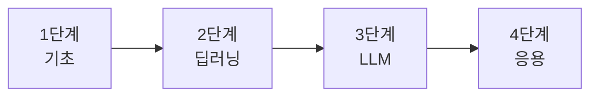

# 학습 로드맵

체크박스를 `[x]`로 바꾸면 완료 표시가 됩니다. 기간은 하루 1~2시간 기준의 대략적인 추정입니다.
각 항목의 **노트**로 개념을 익히고, **실습**으로 직접 구현하세요.

## 1단계 · 기초 <small>(약 4~6주)</small>

### 파이썬 / 데이터
- [ ] 파이썬 문법 — [점프 투 파이썬](https://wikidocs.net/book/1)
- [ ] NumPy, Pandas — [NumPy 노트](notes/01-numpy.md), [Pandas 노트](notes/02-pandas.md) / 참고서: *Python for Data Analysis*
- [ ] **과제**: [Titanic 실습](practice/titanic.md)

### 수학
- [ ] 선형대수 — [노트](notes/03-linear-algebra.md) + 3Blue1Brown *Essence of Linear Algebra*
- [ ] 미적분 / 연쇄법칙 — [노트](notes/04-calculus-gradient.md) + 3Blue1Brown *Essence of Calculus*
- [ ] 확률·통계 기초 — [노트](notes/05-probability.md) + Khan Academy
- [ ] **과제**: [경사하강법 선형 회귀](practice/gradient-descent.md)

### 머신러닝 개념
- [ ] [ML 기초 노트](notes/06-ml-basics.md) + Andrew Ng *Machine Learning Specialization* (Coursera)
- [ ] scikit-learn으로 분류·회귀 한 번씩
- [ ] **과제**: [과적합 실험](practice/overfitting.md)

!!! success "1단계 완료 기준"
    NumPy로 선형 회귀를 경사하강법으로 직접 구현하고, 훈련/검증 분리와 과적합이 무엇인지 설명할 수 있다.

## 2단계 · 딥러닝 <small>(약 6~8주)</small>

- [ ] 신경망과 역전파 — [노트](notes/07-backprop.md) + 3Blue1Brown *Neural Networks*
- [ ] 밑바닥부터 구현 — Karpathy [Neural Networks: Zero to Hero](https://karpathy.ai/zero-to-hero.html) (micrograd)
- [ ] PyTorch 기초 — [노트](notes/08-pytorch.md) + [공식 튜토리얼](https://pytorch.org/tutorials/)
- [ ] CNN — [노트](notes/09-cnn.md) + [Dive into Deep Learning](https://d2l.ai/)
- [ ] RNN과 어텐션의 등장 — [노트](notes/10-rnn-attention.md)
- [ ] **과제**: [MNIST 분류기](practice/mnist-pytorch.md) 정확도 99% 달성

!!! success "2단계 완료 기준"
    역전파를 손으로 유도할 수 있고, PyTorch로 학습 루프(5줄 공식)를 외우지 않고 짤 수 있다.

## 3단계 · LLM <small>(약 6~8주)</small>

- [ ] 토큰화와 임베딩 — [노트](notes/11-tokenization-embedding.md)
- [ ] 트랜스포머 구조 — [노트](notes/transformer.md) + Jay Alammar *The Illustrated Transformer*
- [ ] 논문 읽기 — *Attention Is All You Need*
- [ ] LLM의 학습과 추론 — [노트](notes/12-llm-training.md)
- [ ] Hugging Face — [LLM Course](https://huggingface.co/learn/llm-course) + [실습](practice/hf-transformers.md)
- [ ] 직접 만들기 — Karpathy *Let's build GPT* + [미니 GPT 실습](practice/mini-gpt.md)
- [ ] 프롬프트 엔지니어링 — [노트](notes/13-prompt-engineering.md) + [Anthropic 프롬프트 가이드](https://docs.claude.com/en/docs/build-with-claude/prompt-engineering/overview)
- [ ] **과제**: 작은 GPT를 학습시켜 셰익스피어풍 텍스트 생성

!!! success "3단계 완료 기준"
    어텐션 식을 쓰고 인과 마스크의 역할을 설명할 수 있으며, 샘플링 파라미터(온도/top-k/top-p)가 출력에 미치는 영향을 직접 보여줄 수 있다.

## 4단계 · 응용 <small>(계속)</small>

- [ ] RAG — [노트](notes/14-rag.md) + [RAG 챗봇 실습](practice/rag-chatbot.md)
- [ ] 파인튜닝 — [노트](notes/15-finetuning-lora.md) + [LoRA 실습](practice/lora-finetune.md)
- [ ] 에이전트와 도구 사용 — [노트](notes/16-agents.md) + [에이전트 실습](practice/tool-agent.md)
- [ ] MCP와 API 호출 구조 — [노트](notes/17-mcp.md) + [MCP 실습](practice/mcp-agent.md)
- [ ] **과제**: 위 셋 중 하나를 골라 **평가셋까지 만들어** 개선 전/후를 수치로 비교

!!! success "4단계 완료 기준"
    "프롬프트로 충분한가, RAG가 필요한가, 파인튜닝이 필요한가"를 평가 결과를 근거로 판단할 수 있다.

## 그 다음은?

- 논문 읽기 습관: arXiv에서 매주 한 편, [노트 템플릿](notes/index.md)으로 정리
- 평가(evals) 체계 만들기: 내 과제 전용 평가셋과 자동 채점
- 멀티모달(이미지·음성), 추론 모델, 강화학습 기반 정렬
- 개인 프로젝트: 이 사이트의 노트를 활용하는 학습 도우미를 완성해서 배포

!!! tip "공부 팁"
    강의를 보는 것보다 **직접 구현하고 노트로 정리**하는 쪽이 오래 남습니다. 단계마다 과제 하나는 꼭 끝내고 넘어가세요.
